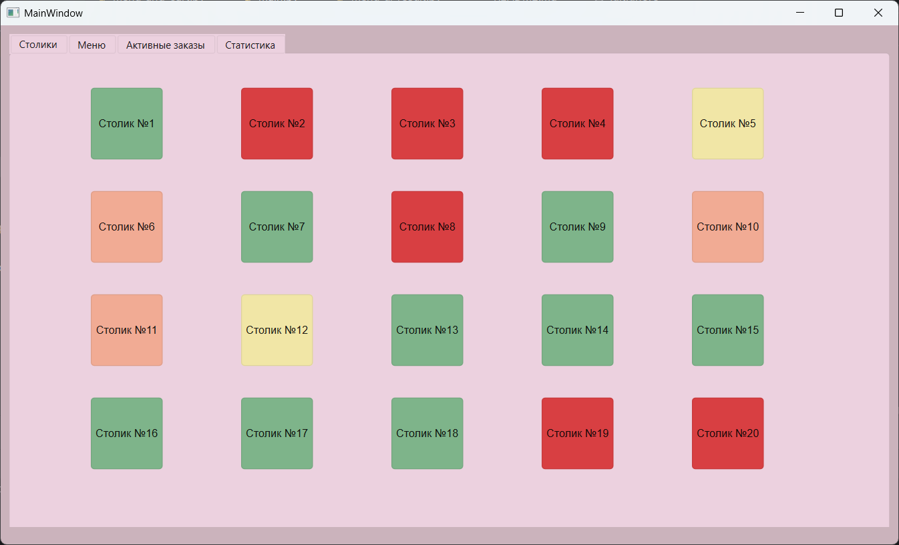
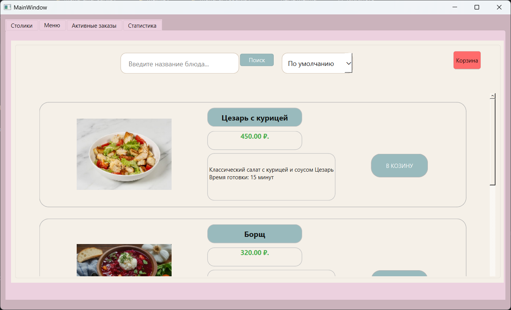
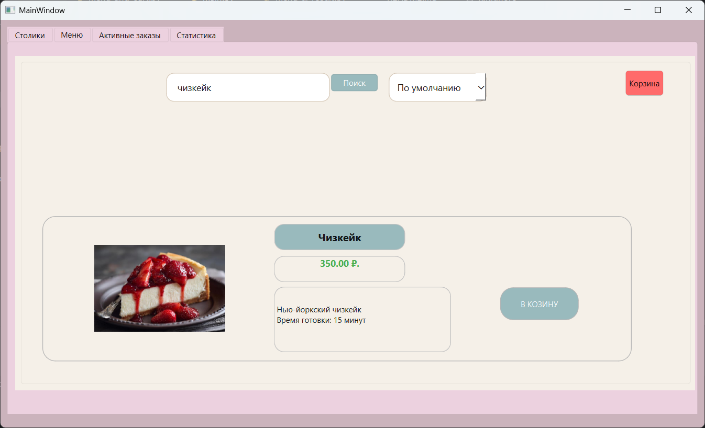
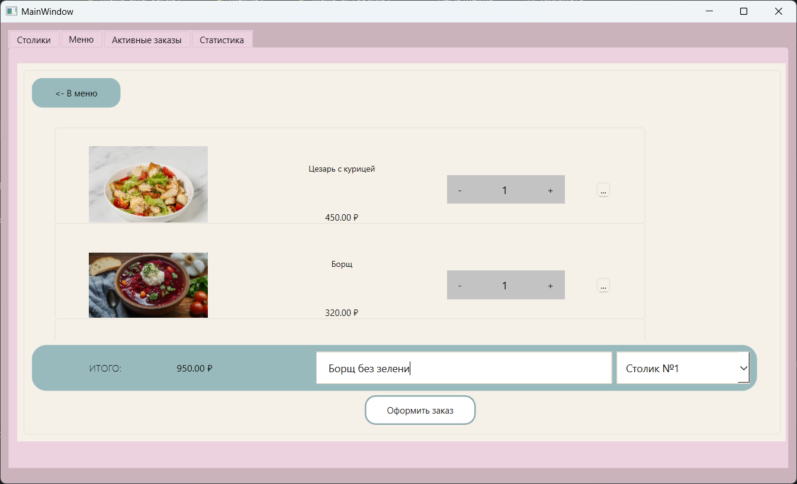
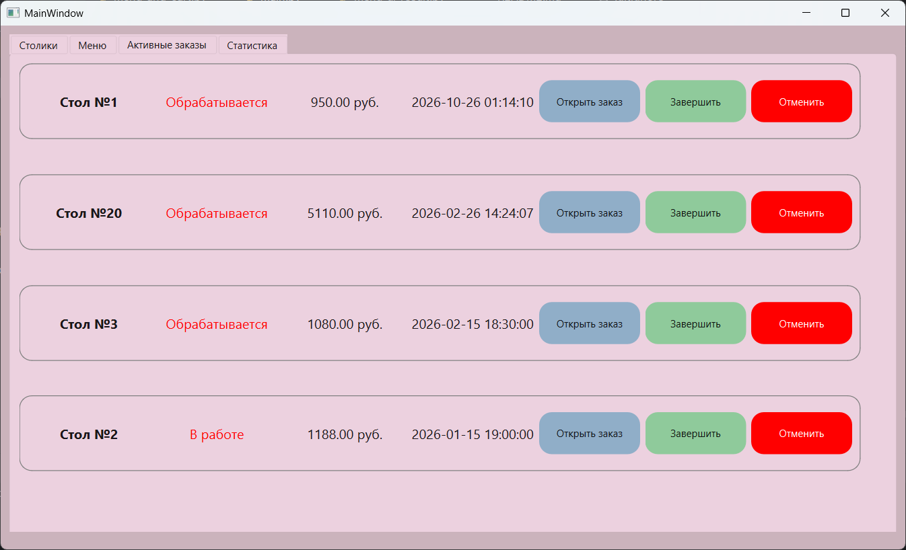
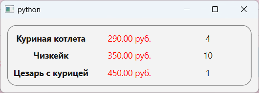
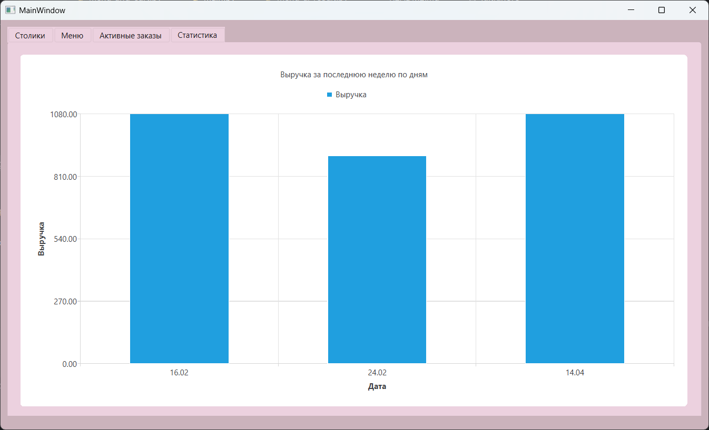

# Restaurant Order Management System

Приложение для автоматизации работы официанта в ресторане. Позволяет управлять столиками, формировать заказы из меню и просматривать статистику выручки.

## Скриншоты
### Столики

### Меню

### Поиск

### Корзина

### Активные заказы

### Информация о заказе

### График выручки



## Стек технологий
- **Язык:** Python 3
- **UI-фреймворк:** PyQt6 (включая PyQt6-Charts для визуализации данных)
- **База данных:** MySQL (через `pymysql`)

## Функционал (Интерфейс официанта)

### 1. Интерактивная карта столиков
- Визуальное отображение всех столиков в виде кнопок
- **Цветовая индикация статусов:** Свободен (зеленый), Занят (красный), Зарезервирован (оранжевый), Не убран (желтый)
- Клик по столику циклически меняет его статус и обновляет данные в БД

### 2. Меню и корзина
- Динамическая загрузка списка блюд из БД с фотографиями и ценами
- Поиск по названию и сортировка по цене
- **Умная корзина:** при добавлении одинаковых блюд количество увеличивается, а не создается новая строка. Поддерживается изменение количества и удаление позиций
- Автоматический пересчет итоговой суммы в реальном времени

### 3. Оформление заказа
- Привязка заказа к конкретному столику
- Возможность оставить комментарий к заказу
- При оформлении заказа создается запись в `orders`, сохраняются все позиции в `order_items`, формируется счет в `bills`, а статус столика меняется на "Занят"

### 4. Статистика (Визуализация данных)
- Построение столбчатой диаграммы (`QBarSeries`) выручки за последние 7 дней
- Данные агрегируются через SQL-запрос

## Структура проекта

```text
restaurant-app/
├── ui_py_files/            # Сгенерированные интерфейсы (карточки, меню, формы)
├── images/                 # Фотографии блюд и иконки
├── bd.py                   # Модуль подключения к БД и функций запросов
├── menu_and_cart.py        # Логика меню и корзины (класс MenuWin)
├── waiter_win.py           # Главное окно официанта (столики, заказы, график)
├── restaurant.sql          # Дамп базы данных (таблицы, тестовые данные)
└── requirements.txt        # Зависимости
```

## Как запустить проект
1. Клонируйте репозиторий:
```
git clone https://github.com/anarkulovab/restaurant_order_management_app_python.git
cd restaurant_order_management_app_python
```

2. Установите зависимости:
```
pip install -r requirements.txt
```

3. Настройте базу данных MySQL:

- Запустите сервер MySQL
- Импортируйте базу данных из файла restaurant.sql
- По умолчанию в файле bd.py настроено подключение: хост localhost, пользователь root, пароль root, база данных restaurant. Если ваши настройки отличаются, измените их в bd.py.

4. Запустите приложение:
```
python main.py
```